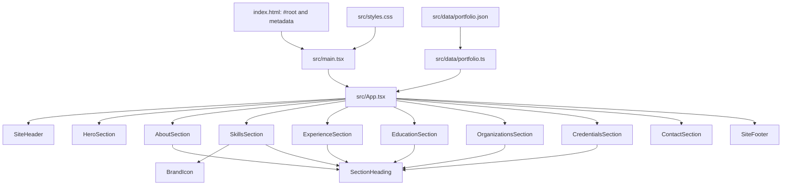

# Ganesh Awasthi — Portfolio

A responsive, single-page portfolio for presenting Ganesh Awasthi's profile, skills, professional experience, education, community work, credentials, and contact information. The project is a static React application: its content is bundled from a local JSON file, and it does not currently use a backend, API, database, authentication, or form submission service.

## Contents

- [Project at a glance](#project-at-a-glance)
- [Technology](#technology)
- [Repository layout](#repository-layout)
- [How the application works](#how-the-application-works)
- [Components and functions](#components-and-functions)
- [Data model](#data-model)
- [Content and asset editing](#content-and-asset-editing)
- [Styling, responsive behavior, and accessibility](#styling-responsive-behavior-and-accessibility)
- [Local development](#local-development)
- [Build and deployment](#build-and-deployment)
- [Vercel deployment guide](./vercel-deploy-guide.md)
- [Design and implementation notes](#design-and-implementation-notes)

## Project at a glance

| Area | Implementation |
| --- | --- |
| Application type | Client-rendered, single-page portfolio |
| UI | React 19 and TypeScript |
| Bundler and development server | Vite 6 |
| Content source | `src/data/portfolio.json` |
| Styling | One global stylesheet, `src/styles.css` |
| Motion | Framer Motion |
| Icons | Lucide React and selected Simple Icons |
| External services | Google Fonts and links to email, LinkedIn, organization, and credential pages |
| Backend | None |
| Automated test script | None currently defined in `package.json` |

The portfolio's profile and resume information has one source of truth: [`src/data/portfolio.json`](./src/data/portfolio.json). The app imports this file through `src/data/portfolio.ts` and passes its values to the components that display them. Change the JSON to update names, contact details, skills, experience, education, organizations, and credentials without changing the layout code.

This does not mean every visible word is JSON-driven: section headings, navigation labels, button text, the About principles, and other design copy are currently defined in the React components. Change those in the relevant component when you mean to change the interface copy rather than portfolio facts.

## Technology

- **React** builds the page from reusable components and semantic sections.
- **TypeScript** checks component and content shapes. Compiler settings are strict, with unused locals and parameters treated as errors.
- **Vite** serves the app locally and creates the production bundle.
- **Framer Motion** provides entrance and in-view animations, including the expandable mobile navigation.
- **Lucide React** supplies general-purpose interface icons.
- **Simple Icons** supplies selected technology brand marks; `BrandIcon` uses Lucide fallbacks for other entries.
- **CSS** defines the visual system, responsive layout, focus treatment, and reduced-motion behavior.

## Repository layout

```text
.
├── index.html                     # Browser document, metadata, fonts, and React mount point
├── package.json                   # Dependencies and npm scripts
├── package-lock.json              # Locked npm dependency graph
├── tsconfig.json                  # Strict TypeScript and JSX settings
├── vite.config.ts                 # React plugin, dev server, and build output settings
├── public/                        # Static assets served from the site root
│   ├── favicon.svg
│   ├── profile image 2.jpeg
│   ├── TCS-Icon-Logo-PNG.png
│   ├── icons/
│   │   └── java.png
│   └── ...                        # NGO and other portfolio images
└── src/
    ├── main.tsx                   # React entry point; imports global CSS
    ├── App.tsx                    # Composes the complete page in display order
    ├── styles.css                 # Global design system and responsive rules
    ├── components/                # Shared site-level and presentation components
    │   ├── BrandIcon.tsx
    │   ├── SectionHeading.tsx
    │   ├── SiteFooter.tsx
    │   └── SiteHeader.tsx
    ├── data/
    │   ├── portfolio.json         # Editable profile and portfolio content
    │   └── portfolio.ts           # Type definitions, data export, email URL helper
    ├── sections/                  # Sections composed by App.tsx
    │   ├── HeroSection.tsx
    │   ├── AboutSection.tsx
    │   ├── SkillsSection.tsx
    │   ├── ExperienceSection.tsx
    │   ├── EducationSection.tsx
    │   ├── OrganizationsSection.tsx
    │   ├── CredentialsSection.tsx
    │   └── ContactSection.tsx
    └── types/
        └── simple-icons.d.ts      # Local declaration for the Simple Icons package API used
```

`public/` is copied into the production site without being imported through the JavaScript module graph. A public asset is referenced by a root URL such as `/profile%20image%202.jpeg`; the URL must match the file name and path in `public/`.

## How the application works

### Startup and rendering

1. The browser loads [`index.html`](./index.html), which provides the `#root` element, page metadata, favicon, font preconnects, and Google Fonts stylesheet.
2. The browser loads [`src/main.tsx`](./src/main.tsx). It imports `src/styles.css`, finds `#root`, and mounts the app with `ReactDOM.createRoot`.
3. `React.StrictMode` wraps the app in development. It enables additional React development checks; it does not add a separate production feature.
4. [`src/App.tsx`](./src/App.tsx) imports the shared data export `PORTFOLIO` and passes the relevant values down to the header, sections, and footer.
5. Each section renders its content from props. Arrays (skills, experience, education, organizations, and credentials) are mapped to repeated cards or badges.
6. CSS controls layout and visual treatment. Framer Motion animates selected elements when they enter the viewport or when the mobile menu opens.



### Visible page order

The order in `App.tsx` is also the visual and reading order:

1. Sticky site header with anchor navigation and an email call to action.
2. Hero: headline, profile title, links, portrait, and scroll cue.
3. About: biography and three engineering principles.
4. Skills: skills grouped into fixed categories and sorted within each group.
5. Experience: roles, company/client context, description, and highlight tags.
6. Education: degree, institution, date, and result.
7. Organizations: community organizations with logos and external links.
8. Credentials: certifications, in-progress learning, recognition, and optional proof links.
9. Contact: email, LinkedIn, phone, location, and optional GitHub.
10. Footer: initials, copyright year, and closing line.

The header navigation links to `#about`, `#skills`, `#experience`, `#organizations`, and `#contact`. Other sections remain accessible in the document flow and some internal calls to action link to them directly.

## Components and functions

### Application entry and composition

| Module | Export | Purpose |
| --- | --- | --- |
| `src/main.tsx` | — | Imports React, `App`, and global CSS, then mounts the application in `#root` under `React.StrictMode`. The non-null assertion on `getElementById('root')` relies on the mount element in `index.html`. |
| `src/App.tsx` | `App()` | Reads `profile`, `skills`, `organizations`, and `credentials` from `PORTFOLIO`; renders decorative background glows, the header, all sections in order, and the footer. |

### Shared components

| Module | Export | Props / behavior |
| --- | --- | --- |
| `components/SiteHeader.tsx` | `SiteHeader({ email, name })` | Renders the wordmark, desktop anchor links, email CTA, and mobile menu button. Local `open` state toggles the mobile navigation; `AnimatePresence` and `motion.nav` animate its appearance and exit. On mobile, choosing a navigation link closes the menu. `firstName` and `surname` are derived from `name` for the wordmark and mobile email label. The link array is a module-level constant. |
| `components/SiteFooter.tsx` | `SiteFooter({ name })` | Derives initials from the name, links the initials back to `#top`, displays the copyright year, and renders the footer tagline. |
| `components/SectionHeading.tsx` | `SectionHeading({ index, eyebrow, title, description? })` | Reusable section heading with an index/kicker, title, and optional supporting description. |
| `components/BrandIcon.tsx` | `BrandIcon({ iconKey?, label, className? })` | Selects a Simple Icon by key when available; the special key `siJava` renders an empty styled element that CSS masks with `/icons/java.png`. Otherwise, a keyword-based fallback selects a Lucide database, cloud, workflow, layers, or generic code icon. Icons are hidden from assistive technology because the skill name is rendered as text beside them. |

### Page sections

Each section is a named React component. Most are presentational and receive data through props; they do not fetch or mutate content.

| Module | Export | What it renders and how it works |
| --- | --- | --- |
| `sections/HeroSection.tsx` | `HeroSection({ profile })` | Uses the profile name, title, email, portrait, LinkedIn, and optional GitHub. Provides links to experience and contact/email. `useReducedMotion()` disables the initial Framer Motion entrance state for users requesting reduced motion. |
| `sections/AboutSection.tsx` | `AboutSection({ bio })` | Renders the bio, a link to organizations, and three module-level principles (secure by design, reliable systems, end-to-end delivery). The bio and principle rows animate into view, with reduced-motion-aware transitions. |
| `sections/SkillsSection.tsx` | `SkillsSection({ skills })` | Iterates over the fixed `categories` list. For each category, filters skills, sorts by `sort_order` (falling back to `id`), omits empty categories, and renders badges through `BrandIcon`. |
| `sections/ExperienceSection.tsx` | `ExperienceSection({ items })` | Maps experience items to timeline-style cards. Optional company logo, client, and location are shown only when supplied; `highlights` become tags. The item key combines company and period. |
| `sections/EducationSection.tsx` | `EducationSection({ items })` | Maps education items to cards with a graduation icon, period, result, degree, and institution. The key combines degree and institution. |
| `sections/OrganizationsSection.tsx` | `OrganizationsSection({ organizations })` | Displays each organization with an index, NGO label, logo, and external website link. Links open in a new tab with `noopener noreferrer`; cards animate into view and lift on hover unless reduced motion is requested. |
| `sections/CredentialsSection.tsx` | `CredentialsSection({ credentials })` | Maps credentials to cards. `kind` selects the certification or recognition icon; optional status is shown as a badge, and each optional proof URL becomes an external link. |
| `sections/ContactSection.tsx` | `ContactSection({ profile })` | Builds the email CTA and displays LinkedIn, telephone, location, and optional GitHub details. The phone link uses a `tel:` URL. |

### Data helper

`src/data/portfolio.ts` exports `getEmailComposeUrl(email, subject?)`. It creates a Google Mail compose URL and uses `URLSearchParams` for `view=cm`, `fs=1`, `to`, and `su`. The default subject is `Portfolio inquiry`. The header, hero, and contact section use this helper; it opens Gmail in a new tab.

## Data model

The portfolio facts are authored in `src/data/portfolio.json` and imported by `src/data/portfolio.ts`. TypeScript interfaces in the latter describe the intended shape. `PORTFOLIO` is exported as `PortfolioPayload`, but this is a compile-time cast: the JSON is not runtime-validated or guaranteed to be checked against those interfaces. Use the data types below as the editing contract, then validate the content with the checks and review steps in [Safe JSON editing workflow](#safe-json-editing-workflow).

### JSON-to-UI impact map

The route from content to display is:

```text
src/data/portfolio.json
    -> src/data/portfolio.ts (imports JSON; exports PORTFOLIO and the TypeScript types)
    -> src/App.tsx (selects values and passes them as props)
    -> section/component (renders the values in the page)
```

Changing a value in the JSON updates the corresponding rendered content after the app reloads or is rebuilt. The impact for each top-level property is:

| JSON path | Where `App.tsx` passes it | Where it appears / what uses it |
| --- | --- | --- |
| `profile.name` | `SiteHeader`, `HeroSection`, `SiteFooter` | Header wordmark and its accessible label, hero greeting and portrait alt text, and footer initials. |
| `profile.title` | `HeroSection` | Role shown next to the name in the hero. |
| `profile.email` | `SiteHeader`, `HeroSection`, `ContactSection` | Email compose links in the header, hero actions/social row, and contact panel. The URL is formed by `getEmailComposeUrl` in `src/data/portfolio.ts`. |
| `profile.phone` | `ContactSection` (via `profile`) | Visible phone number and the `tel:` link. |
| `profile.location` | `ContactSection` (via `profile`) | Location line in the contact panel. |
| `profile.linkedin_url` | `HeroSection`, `ContactSection` (via `profile`) | LinkedIn links in the hero and contact panel. |
| `profile.github_url` | `HeroSection`, `ContactSection` (via `profile`) | Optional GitHub links. Set to `null` to hide them; use a valid URL to show them. |
| `profile.bio` | `AboutSection` as `bio` | Biography paragraph in About. |
| `profile.image_path` | `HeroSection` (via `profile`) | Hero portrait image; must point to a real file under `public/`. |
| `profile.experience` | `ExperienceSection` as `items` | Experience cards, including their optional logos, client/location, descriptions, periods, and highlight tags. |
| `profile.education` | `EducationSection` as `items` | Education cards with degree, institution, period, and result. |
| `skills` | `SkillsSection` as `skills` | Skill groups and badges. Category and sort behavior is described in the `Skill` type below. |
| `organizations` | `OrganizationsSection` as `organizations` | Organization cards, images, and external website links. |
| `credentials` | `CredentialsSection` as `credentials` | Certification/recognition cards, statuses, and optional proof links. |

`src/App.tsx` is the wiring point: if you add an entirely new top-level data collection, updating the JSON alone will not display it. Add or update its TypeScript type in `src/data/portfolio.ts`, read it from `PORTFOLIO` in `App.tsx`, and pass it to a section component that renders it.

The JSON does not currently control the section headings, menu labels, hero headline, About principles, contact-panel prompt, or footer tagline. Those are presentation copy in the corresponding `.tsx` modules, so changing a JSON field will not change them.

### `PortfolioPayload`

The top-level object contains:

| Property | Type | Used by |
| --- | --- | --- |
| `profile` | `Profile` | Header, hero, about bio, experience, education, contact, and footer. |
| `skills` | `Skill[]` | Skills section. |
| `organizations` | `Organization[]` | Organizations section. |
| `credentials` | `Credential[]` | Credentials section. |

### `Profile`

| Field | Type | Notes |
| --- | --- | --- |
| `name` | `string` | Used for the wordmark, hero, portrait alt text, and footer initials. |
| `title` | `string` | Role shown in the hero. |
| `location` | `string` | Displayed in contact details. |
| `phone` | `string` | Displayed in contact details and used to build the `tel:` link. |
| `email` | `string` | Passed to `getEmailComposeUrl`. |
| `linkedin_url` | `string` | External LinkedIn link. |
| `github_url` | `string \| null` | Optional in the UI; when `null`, GitHub links are omitted. |
| `bio` | `string` | About section copy. |
| `image_path` | `string` | Root-relative public asset URL for the portrait. |
| `experience` | `ExperienceItem[]` | Work history. |
| `education` | `EducationItem[]` | Education history. |

### Repeated content types

**`Skill`**

| Field | Type | Notes |
| --- | --- | --- |
| `id` | `number` | Stable React key. |
| `name` | `string` | Visible label and fallback icon matching input. |
| `category` | `string` | Must match one of the four category labels in `SkillsSection` to render. |
| `icon_key?` | `string \| null` | Optional key for `BrandIcon`; unmatched values use the keyword/generic fallback. |
| `sort_order?` | `number` | Optional display order; missing values sort using `id`. |

The currently recognized category labels are `Languages & Frameworks`, `Cloud & DevOps`, `Concepts`, and `Tools & OS`. A new category requires adding its exact label to the `categories` array in `SkillsSection.tsx`.

**`ExperienceItem`**

| Field | Type | Notes |
| --- | --- | --- |
| `role` | `string` | Job title. |
| `company` | `string` | Employer or company. |
| `client?` | `string` | Optional client shown after the company. |
| `location?` | `string` | Optional location shown after the company/client. |
| `period` | `string` | Display string for the time period. |
| `description` | `string` | Role summary. |
| `highlights` | `string[]` | Short items rendered as tags. |
| `company_logo_path?` | `string` | Optional root-relative path to a public logo. |

**`EducationItem`**

| Field | Type | Notes |
| --- | --- | --- |
| `degree` | `string` | Qualification shown as the card title. |
| `institution` | `string` | School or institution. |
| `period` | `string` | Display string for the date or period. |
| `result` | `string` | CGPA, score, or other result. |

**`Organization`**

| Field | Type | Notes |
| --- | --- | --- |
| `name` | `string` | Visible organization name and image alt-text source. |
| `url` | `string` | External website URL and React key. |
| `image_path` | `string` | Root-relative public asset path for the logo. |

**`Credential`**

| Field | Type | Notes |
| --- | --- | --- |
| `kind` | `'Certification' \| 'Recognition'` | Selects the card icon and visible type. |
| `title` | `string` | Card title and React key; keep titles unique. |
| `description` | `string` | Explanation shown below the title. |
| `status?` | `'Certified' \| 'In progress'` | Optional badge; only `In progress` gets the in-progress styling. |
| `proof_urls?` | `string[]` | Optional external evidence links; omitted or empty means no proof-link row. |

### `BrandIcon` and Simple Icons types

`src/types/simple-icons.d.ts` declares the subset of the `simple-icons` package API used by this project: a `SimpleIcon` with `title`, `hex`, and `path`, and the named icons `siGit`, `siGithub`, `siJavascript`, `siMysql`, `siReact`, `siSpring`, and `siSpringboot`. The renderer currently reads the icon `path` to draw an SVG.

The registry only contains those brand exports. For example, `siJava` is not loaded from the package: it is a special CSS-mask case that depends on `public/icons/java.png`. For other unknown icon keys, `BrandIcon` checks the combined key and label for database/SQL, cloud/AWS/Jenkins, workflow/CI/CD/microservices, or layer/design terms; if none match, it uses a generic code icon.

## Content and asset editing

### Safe JSON editing workflow

For a routine content update:

1. **Start with one field or one record.** Open `src/data/portfolio.json` and locate the matching top-level property. Use the [JSON-to-UI impact map](#json-to-ui-impact-map) to see which section(s) the change affects.
2. **Preserve the expected shape.** Treat the interfaces in `src/data/portfolio.ts` as the contract. Keep required fields, field types, and literal values intact. For example, `Credential.kind` only supports `"Certification"` or `"Recognition"`, and `Credential.status` only supports `"Certified"` or `"In progress"`.
3. **Keep JSON syntax valid.** Use double quotes around keys and string values, separate array items and object fields with commas, and do not leave a trailing comma. Escape quotes inside strings. Avoid adding comments; JSON does not support comments.
4. **Preserve stable, unique keys.** Give each skill a unique numeric `id`; keep credential titles unique; avoid duplicate organization URLs. Experience and education cards also derive their React keys from combinations of their fields, so avoid duplicate company/period or degree/institution pairs.
5. **Check conditional values carefully.** Optional fields may be omitted where the type and component allow it. Use `null` for `github_url` when there is no GitHub profile. Use `[]` for an intentionally empty list. Do not replace required arrays or strings with `null`.
6. **Check categories and ordering.** A skill's `category` must exactly match a label in `SkillsSection.tsx`, or that skill will not render. `sort_order` controls order inside its category; if omitted, the skill's `id` is used as the order value.
7. **Check links and assets.** Use complete, correct URLs for external links. Put image files in `public/` and use root-relative paths (for example `"/profile_image.png"`). URL-encode spaces (for example `"/profile%20image%202.jpeg"`), and verify the referenced file exists with the same path and filename.
8. **Run checks and inspect the page.** Run the commands below, then start `npm run dev` and check every affected section at desktop and mobile widths. Also click changed links and confirm images load.

```bash
npm run check
npm run build
```

**Senior-engineer tips**

- Make small, reviewable edits instead of replacing the whole JSON file. This makes accidental deletions, malformed arrays, and unrelated content changes easier to catch in code review.
- Treat the data interfaces as documentation, not runtime validation. Because the imported JSON is asserted as `PortfolioPayload`, a TypeScript check may not catch every malformed or missing JSON field. A successful build alone does not prove that the correct content, URL, or image is displayed.
- Check the rendered result, not only the diff. Broken asset paths can still pass TypeScript and build checks; bad URLs can compile but send visitors to the wrong destination.
- Keep presentation changes separate from content changes: update the JSON for portfolio facts; update the relevant component for fixed headings, labels, or explanatory copy; update `SkillsSection.tsx` if adding a skill category.
- Do not add secrets or information that should not be public. The JSON is bundled into client-side assets, and everything under `public/` is directly accessible to site visitors.

For an image update, put the file in `public/` (or a subdirectory) and set its root-relative URL in the corresponding JSON field. For skills, use a supported category and an icon key handled by `BrandIcon`; add a custom brand mapping only when a corresponding icon is available and appropriate.

## Styling, responsive behavior, and accessibility

- `src/styles.css` owns the global color and typography variables, page layout, cards, buttons, focus indicators, animations, and breakpoints.
- The visual system uses a dark background with teal accents, Space Grotesk display headings, Inter body text, and JetBrains Mono labels. Google Fonts are loaded by `index.html`; system fallbacks are defined in CSS.
- The header is sticky. Desktop navigation and CTA are hidden at the `700px` breakpoint and replaced by an expandable mobile menu.
- Layout adjustments are defined at `900px`, `700px`, and `420px`; credential columns also adapt to tablet and mobile widths.
- Sections and cards use `useReducedMotion()` to avoid Framer Motion entrance/hover movement when reduced motion is requested. CSS also disables smooth scrolling and shortens animations/transitions under `prefers-reduced-motion: reduce`.
- Interactive anchors and buttons receive a visible `:focus-visible` outline. Decorative glows and icons are marked `aria-hidden`; content images include descriptive alt text, and icon-only controls have labels.
- External links opened in a new tab use `rel="noopener noreferrer"`.

## Local development

### Prerequisites

- Node.js and npm installed.
- Dependencies installed from the repository lockfile.

### Install and run

```bash
npm install
npm run dev
```

The Vite development server uses port `3000`, binds to `0.0.0.0`, and fails rather than selecting another port if `3000` is occupied (`strictPort`). Open `http://localhost:3000`.

### Available scripts

| Command | What it does |
| --- | --- |
| `npm run dev` | Starts the Vite development server on port 3000. |
| `npm run check` | Runs the TypeScript compiler without emitting files. |
| `npm run build` | Runs the TypeScript check, then creates the Vite production build. |
| `npm run preview` | Serves the built `dist/` output on port 4173; run `npm run build` first. |

There is no test or lint script currently configured in `package.json`.

## Build and deployment

Run:

```bash
npm run build
```

This first executes `tsc --noEmit` and then writes the static production site to `dist/`. Vite is configured with `sourcemap: false`, so source maps are not emitted. The output can be hosted on a static web server or static hosting provider. Configure the host to serve `index.html` for the site root; if deploying below a URL subpath, review Vite's `base` setting and the root-relative URLs used for public assets before publishing.

To inspect the production output locally:

```bash
npm run preview
```

## Design and implementation notes

- **Single source of portfolio content:** `portfolio.json` keeps content separate from presentation, while `portfolio.ts` provides compile-time interfaces and the shared email URL helper.
- **Static rendering model:** there are no API calls or server-side dependencies. Visitors download the app bundle and the public content/assets required to render the site.
- **Small local state surface:** the only interactive React state in the page components is the mobile menu's open/closed state in `SiteHeader`.
- **Section headings:** most content sections share `SectionHeading`; the contact panel uses its own kicker and title layout.
- **Animations are progressive presentation:** the content remains ordinary page content, and reduced-motion preferences are respected in both component animations and CSS.
- **Types do not validate JSON at runtime:** if external or user-edited data is introduced later, add runtime validation rather than relying on `PORTFOLIO`'s TypeScript assertion.
- **No contact form:** email actions open a Gmail compose URL; they do not submit data to this application.
